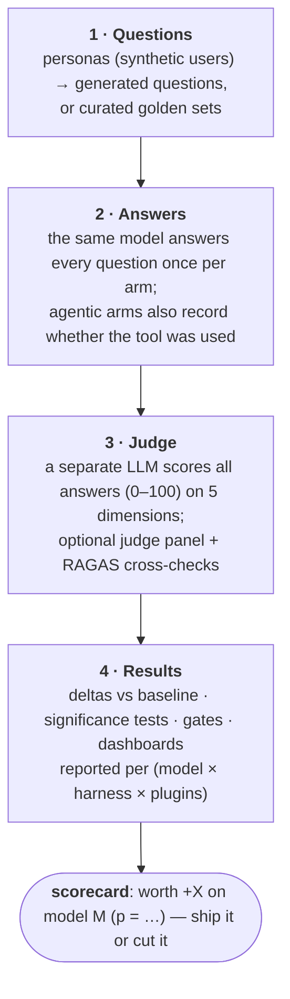
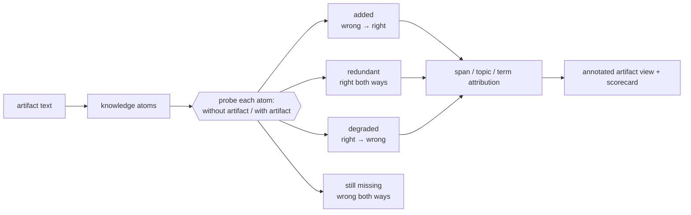

<!--
Copyright (C) 2026 Intel Corporation
SPDX-License-Identifier: Apache-2.0
-->

# How the evaluation works

How a Dokimi evaluation flows, which question each part answers, and why the evidence is kept per artifact. This page was moved from the docs home. The [documentation index](documentation-index.md) lists every guide.

## How the evaluation flows



Two more tracks back this up:

- **Static track** — LLM-free checks on the docs themselves: structure,
  freshness, readability, do the code examples run.
- **Executable task track** — Docker tasks supplied from an external content
  checkout ([external-content.md](external-content.md) covers how to point the
  framework at one): the agent must edit code, compile, and pass tests
  in Docker. A judge can be fooled by prose; a pytest verifier cannot. The
  [coding harnesses guide](coding-harnesses.md) explains how to run Codex,
  Claude Code, or any Harbor agent against these tasks and compare pass rate
  against a baseline harness; the task format itself is specified in
  [contributing-terminal-bench-task.md](contributing-terminal-bench-task.md).

## Asking a different question

Everything above answers *does this artifact help?* — one number per artifact,
with a p-value. Two tracks keep the same machinery and change the question.

### Content novelty: which parts help?

A skill is not homogeneous. One delta cannot tell you that 70% of a file is the
model's own prior knowledge written back at you, 21% is genuinely new, and 2% is
knowledge the model *had* and the file destroyed — but those three need opposite
edits. So each checkable claim in the artifact is probed twice against the same
model, once without the artifact and once with it, and a different model grades
both answers:



How an author uses it:

```bash
python cli.py skill novelty analyze --artifact skill:path/to/skill \
    --model <model under measurement> --judge-model <a different model> \
    --budgets 0.75 0.5
```

`analyze` says what the file is worth and where, and then (unless you pass
`--no-shorten`) proposes a smaller version at each budget and scores it on five
axes — tokens, knowledge, value, protection, routing — so cutting tokens cannot
quietly cut the safety clause. To shorten without probing, run the stages on
their own: `skill novelty atoms` writes `atoms.json`, and
`skill shorten --atoms atoms.json` scores candidates from it. Two properties
to keep in mind: the result belongs to the (artifact, **model**) pair, so a file
that looks bloated against a frontier model may be correctly sized for a small
one; and the probes are paired, so trust the signs and the rankings, not the
second decimal. Guide: [skill-novelty.md](skill-novelty.md). The study behind the
defaults, with the caveat attached to every number:
[skill-novelty-evidence.md](skill-novelty-evidence.md).

### Repositories as subjects: does the repo's own guidance land?

Here the subject is not a document handed to the framework but a codebase, and
the material under test is what that codebase already tells agents — `CLAUDE.md`,
`AGENTS.md`, `.github/copilot-instructions.md`, contributor docs. The repository
declares what evaluating it means in a `repo-eval.yaml` manifest, and its tasks
and graders stay in **its** tree, so they can evolve with it instead of rotting
in a copy here.

```bash
python cli.py repo validate <dir | dir@rev | url@rev>   # is the manifest honest?
python cli.py repo reach   <source> --model <id>        # which guidance actually loads?
```

The reach probe exists because a harness's documented loading rules and its
behaviour are different things. It stands up a workspace holding the repo's
guidance files at their real paths, plants a head and a tail token in each, and
asks the agent which tokens it can see — so a file comes back `loaded`,
`truncated` (only one token: it was cut), `fetched` (seen only after the agent
opened it), `not_loaded`, or `error` (the scenario gave no usable answer).
Guidance nobody reads cannot help anyone, which makes this the cheapest check
to run first.
[repo-evaluation-contract.md](repo-evaluation-contract.md) is the interface a
repository codes against. Its core is implemented; scoped extensions are marked as such in that document.

## Why this matters

Marketplaces rank agent artifacts by popularity, which buries niche expert
tooling such as HPC and performance libraries (the bundled examples use
oneTBB, oneDAL and oneMKL).
Here, every shipped skill, doc source, or profile carries the **scorecard
that earned it**, built from the run that measured it. See the
[repository overview](../../README.md) for what this framework is and where the
content it measures comes from.

